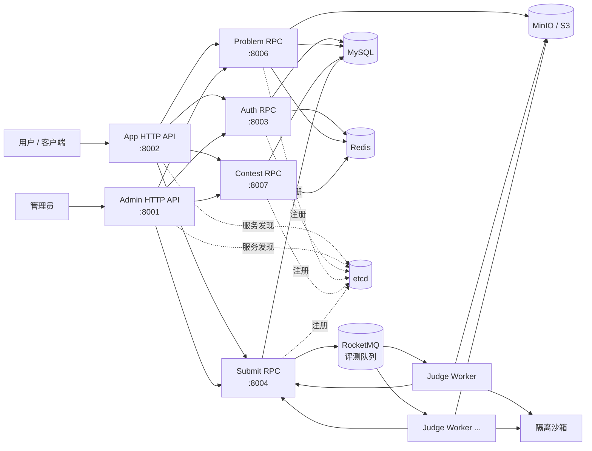

# GoCompetitiveOnlineJudge

GoCompetitiveOnlineJudge是一个安全隔离的分布式代码执行与调度平台，覆盖用户认证、题目管理、代码提交、沙箱评测、比赛组织和实时排行榜等完整 OJ 业务。

项目基于 go-zero 拆分 HTTP 网关与 gRPC 服务，通过 etcd 完成服务发现，使用 MySQL 持久化业务数据、Redis 承载缓存与限流、RocketMQ 分发异步评测任务、MinIO/S3 保存测试数据，并通过可水平扩展的 Judge Worker 执行用户代码。

## 功能特性

### 用户与权限

- 用户名、邮箱密码和邮箱验证码登录
- JWT Access Token、Refresh Token 轮换与会话注销
- 注册、找回密码、修改邮箱和个人资料维护
- 普通用户、管理员和超级管理员三级角色
- 用户禁用、封禁和软删除
- HTTP、gRPC 与内部服务调用的分层鉴权

### 题目管理

- Markdown 题面、公开样例、难度、标签和来源信息
- 草稿、发布、归档、删除与恢复生命周期
- 公开、私有和仅比赛可见三种可见性
- 时间、内存、语言和 Checker 配置
- 标准答案比较、Special Judge 与交互题扩展能力
- 测试数据预签名上传、ZIP 安全校验和不可变版本管理
- 基于 revision 的乐观锁，避免并发编辑覆盖

### 提交与评测

- C++、Go 等语言执行器，支持按需扩展新语言
- 异步评测队列、失败重试、幂等回报和 Worker 心跳
- 编译、运行、答案检查和逐测试点评测
- CPU 时间、内存、进程数、文件大小和网络访问限制
- Accepted、Wrong Answer、Time Limit Exceeded、Memory Limit Exceeded、Runtime Error、Compile Error 等标准结果
- 提交详情、测试点结果、重判与批量重判
- 多个 Judge Worker 水平扩容和任务自动分发

### 比赛系统

- ICPC、IOI 和 OI 三种比赛模式
- 公开、不公开和私有比赛
- 开放报名、审核报名和邀请码报名
- 比赛题目编排、参赛资格校验与比赛内提交限制
- 实时排行榜、稳定排名与分页查询
- ICPC 自动/手动封榜及赛后解封
- 比赛发布、取消、归档、删除与恢复
- 参赛者审核、退赛和取消资格

### 平台能力

- 用户端与管理端独立 HTTP API
- gRPC 内部服务通信与 etcd 服务发现
- MySQL 数据迁移、Redis 缓存、RocketMQ 异步消息和 S3 兼容对象存储
- 结构化日志、健康检查、限流、超时和优雅退出
- 单元测试、集成测试、覆盖率和代码生成工作流

## 系统架构



一次提交的主要链路如下：

1. App API 校验用户身份并将提交交给 Submit RPC。
2. Submit RPC 向 Problem RPC 获取绑定 revision 的判题配置；比赛提交还会向 Contest RPC 校验参赛资格和时间窗口。
3. 提交记录与 Outbox 事件在同一 MySQL 事务中落库，由发布器将评测任务投递到 RocketMQ。
4. Judge Worker 获取测试数据，在无网络的受限沙箱中完成编译和运行。
5. Worker 回报逐测试点结果，Submit RPC 聚合最终状态并更新比赛榜单。

## 技术栈

| 分类 | 技术 |
|---|---|
| 开发语言 | Go 1.26+ |
| 微服务框架 | go-zero、gRPC、Protocol Buffers |
| 服务发现 | etcd |
| 数据库 | MySQL 8.4 |
| 缓存与限流 | Redis 8 |
| 消息队列 | RocketMQ |
| 对象存储 | MinIO / Amazon S3 兼容存储 |
| 沙箱 | Docker、Linux namespaces、cgroups |
| 本地编排 | Docker Compose |
| 代码生成 | goctl、protoc |

## 服务与端口

| 服务 | 默认端口 | 说明 |
|---|---:|---|
| `admin-api` | 8001 | 管理端 HTTP API |
| `app-api` | 8002 | 用户端 HTTP API |
| `auth-rpc` | 8003 | 认证、令牌、用户与权限 |
| `submit-rpc` | 8004 | 提交、评测状态与重判 |
| `problem-rpc` | 8006 | 题目、测试数据与判题配置 |
| `contest-rpc` | 8007 | 比赛、报名与排行榜 |
| MySQL | 3307 | 本地映射端口，容器内为 3306 |
| Redis | 6379 | 缓存与限流 |
| RocketMQ NameServer | 9876 | Broker 注册与路由发现 |
| RocketMQ Broker | 10911 | 评测任务消息存储与投递 |
| etcd | 2379 | 服务注册与发现 |
| MinIO API | 9000 | 测试数据对象存储 |
| MinIO Console | 9001 | 对象存储管理界面 |

Judge Worker 为异步消费者，不对公网暴露固定端口。

Contest RPC 使用 `ScoreboardFreeze` 配置定期扫描已到封榜时间的 ICPC 比赛，并通过比赛 revision 与事务快照保证多实例竞争下只有一个实例完成封榜。该任务只冻结已有排行榜投影，不负责实时计分；默认扫描间隔 10 秒、批量 100 场、单场超时 5 秒。

评测队列使用 `judge-task` Topic 和 `judge-workers` Consumer Group，以 `submission_id` 作为消息路由 Key，以数据库 Attempt 租约和稳定 Report ID 保证业务幂等。Worker 在评测结果成功持久化后再确认消息，队列采用“至少一次”投递，并为超出重试上限的任务保留死信消息。

## 快速开始

### 环境要求

- Go 1.26 或更高版本
- Docker 24+ 与 Docker Compose v2
- GNU Make
- OpenSSL
- 需要重新生成代码时，额外安装 `goctl`、`protoc`、`protoc-gen-go` 和 `protoc-gen-go-grpc`

### 1. 获取项目

```bash
git clone https://github.com/KH2PO4NILL/GoCompetitiveOnlineJudge.git
cd GoCompetitiveOnlineJudge
```

### 2. 初始化本地配置与依赖

```bash
make tools-infra
make infra-env
make infra-up
```

`make infra-env` 会创建权限为 `0600` 的 `.env`，并为 MySQL、Redis、JWT、MinIO 和内部服务调用生成随机密钥。`make infra-up` 会启动 MySQL、Redis、etcd、MinIO，执行数据库迁移并创建测试数据 Bucket。

> RocketMQ NameServer、Broker/Proxy 已接入 Compose。运行 `docker compose --env-file .env up -d --wait rocketmq-namesrv rocketmq-broker`，然后 `docker compose --env-file .env --profile init run --rm rocketmq-init` 创建判题 Topic/Group。Proxy 默认 `127.0.0.1:18081`；配置和可靠性约定见 `infra/rocketmq/README.md`。

若要启用邮件验证码，请在 `.env` 中补充：

```dotenv
AUTH_MAIL_USERNAME=your@example.com
AUTH_MAIL_PASSWORD=your_smtp_password
AUTH_MAIL_FROM=your@example.com
```

SMTP 主机、端口和加密方式可在 `services/grpc/auth/etc/auth.yaml` 中配置。

### 3. 启动后端服务

先让当前 Shell 加载本地环境变量：

```bash
set -a
. ./.env
set +a
```

然后分别启动各服务：

```bash
go run ./services/grpc/auth -f services/grpc/auth/etc/auth.yaml
go run ./services/grpc/problem -f services/grpc/problem/etc/problem.yaml
go run ./services/grpc/contest -f services/grpc/contest/etc/contest.yaml
go run ./services/grpc/submit -f services/grpc/submit/etc/submit.yaml
go run ./cmd/app -f cmd/app/etc/app-api.yaml
go run ./cmd/admin -f cmd/admin/etc/admin-api.yaml
go run ./judge-worker -f judge-worker/etc/judge-worker.yaml
```

开发时建议在不同终端中运行这些进程。需要提高评测吞吐量时，应为每个 Judge Worker 配置不同的 `Worker.ID`。

#### Judge Worker Docker 沙箱

Worker 启动时会连接 `Sandbox.Docker.Endpoint`，并先清理由当前 `Worker.ID` 创建但未正常回收的沙箱容器。Docker daemon 必须运行在 Linux 上，运行镜像由可信的语言执行器预先配置并加载；沙箱不会根据用户输入自动拉取镜像。

默认配置使用：

```yaml
Sandbox:
  Driver: docker
  WorkDir: .run/judge-worker/work
  Docker:
    Endpoint: unix:///var/run/gcoj-docker-proxy.sock
    AllowUnrestrictedDaemon: false
    User: "65532:65532"
    APITimeoutSeconds: 10
    StopTimeoutSeconds: 5
    NanoCPUs: 1000000000
```

`TestDataCache.Dir` 与 `Sandbox.WorkDir` 必须是互不包含的独立目录。测试数据目录仅允许只读挂载，工作目录才允许读写挂载；所有容器内挂载点必须位于 `/sandbox/` 下。

每次执行都直接传递 `Program` 与 `Args`，不会拼接命令字符串或隐式调用 `sh -c`。容器固定启用以下边界：

- 非 root 数字 UID/GID；
- `network=none`，禁用网络；
- RootFS 只读，仅提供受限 `/tmp` tmpfs 和显式允许的挂载；
- 删除全部 Linux capabilities，并启用 `no-new-privileges`；
- 禁止特权模式、自动重启和 Docker 容器日志落盘；
- 设置 CPU、Wall Time、内存、输出、PID 与文件描述符上限；
- 请求取消或超限后强制终止并删除容器。

沙箱返回执行事实，包括退出码、可识别的终止信号、CPU/Wall Time、峰值内存及 stdout/stderr。结果分为 `normal`、`signal`、`time_limit_exceeded`、`memory_limit_exceeded`、`output_limit_exceeded` 和 `sandbox_error`；AC、WA、CE、RE 等评测结论仍由上层 Judge Engine 根据编译阶段和 Checker 结果产生。

> **Docker API 权限边界：** 能访问完整 Docker socket 的进程通常等同于拥有宿主机高权限。Worker 默认连接 `unix:///var/run/gcoj-docker-proxy.sock`，生产环境必须由运维提供受限 API 代理，只放行沙箱需要的容器创建、启动、等待、统计、检查、终止、删除、列表和 Ping 操作。配置会拒绝明文 `tcp://`/`http://` Endpoint，也会默认拒绝 `/var/run/docker.sock` 与 `/run/docker.sock`。只有隔离的本地开发主机可以同时设置 `Endpoint: unix:///var/run/docker.sock` 和 `AllowUnrestrictedDaemon: true`。远程 Endpoint 必须使用经过证书校验的 `https://`。无论采用哪种方式，都不要把 Docker socket 挂入评测容器、向提交代码暴露 Endpoint，或让不受信任用户修改镜像和挂载根目录。

Docker 集成测试默认跳过，运行前需要预加载一个 Linux 镜像：

```bash
JUDGE_DOCKER_INTEGRATION=1 \
JUDGE_SANDBOX_TEST_IMAGE=alpine:3.20 \
JUDGE_DOCKER_ENDPOINT=unix:///var/run/docker.sock \
go test ./judge-worker/internal/sandbox -run TestDockerSandboxIntegration -v
```

集成测试会显式启用仅用于测试的完整 daemon 访问。直接运行 Worker 做本地开发时，还需设置 `JUDGE_DOCKER_ALLOW_UNRESTRICTED_DAEMON=true`；生产环境不得启用该开关。

### 4. 检查基础设施

```bash
make infra-ps
make infra-logs
```

本地 MinIO Console 默认位于 <http://127.0.0.1:9001>。登录凭据保存在 `.env` 中。

### 5. 停止或重置环境

```bash
# 停止容器并保留数据
make infra-down

# 删除容器及本地数据卷
make infra-reset
```

`make infra-reset` 会永久删除本地 MySQL、Redis、etcd 和 MinIO 数据，请谨慎执行。

## 配置说明

项目使用 YAML 保存服务结构配置，使用环境变量注入凭据。请勿将真实密钥写入 YAML 或提交 `.env`。

| 环境变量前缀 | 用途 |
|---|---|
| `MYSQL_*` | 本地 MySQL 容器与数据库账号 |
| `REDIS_*` | Redis 地址与认证信息 |
| `ROCKETMQ_*` | RocketMQ NameServer、Topic、Producer Group 与 Consumer Group 配置 |
| `AUTH_*` | Auth RPC 数据库、JWT 和 SMTP 配置 |
| `PROBLEM_*` | Problem RPC 数据库、Redis、对象存储和内部调用凭据 |
| `CONTEST_*` | Contest RPC 数据库、缓存和内部调用凭据 |
| `SUBMIT_*` | Submit RPC 数据库、队列和服务间鉴权凭据 |
| `JUDGE_*` | Worker 标识、并发度、沙箱、语言与服务间鉴权配置 |
| `MINIO_*` | 本地对象存储账号、端口和 Bucket |

### gRPC 统一鉴权

所有 gRPC 服务统一使用 `infra/interceptor` 中的鉴权拦截器，不在各服务内重复解析 Token 或实现独立鉴权中间件：

- 用户请求通过 `authorization: Bearer <access-token>` 传递身份。Auth RPC 使用本地校验后端，其他 RPC 统一调用 Auth RPC 校验，并将最新用户身份写入请求 Context。
- 公开方法跳过用户鉴权；可匿名查询使用可选鉴权，携带 Token 时仍会严格校验并注入身份；其他方法默认必须登录。
- 内部 RPC（包括业务服务调用 Auth RPC 的 `ValidateToken`）使用 `x-service-name` 和 `x-service-token` 验证调用方，并按完整 RPC 方法维护调用方白名单。内部凭据不得从外部请求透传。
- 缺少或无效凭据统一返回 `Unauthenticated`，身份有效但无权限统一返回 `PermissionDenied`，鉴权依赖不可用统一返回 `Unavailable`。
- Unary RPC 与 Stream RPC 使用相同策略；业务代码统一通过公共 Context 方法读取用户或内部服务身份。

本地的 Problem/Contest → Auth 调用分别使用 `AUTH_INTERNAL_PROBLEM_TOKEN`、`AUTH_INTERNAL_CONTEST_TOKEN`，Problem → Contest 使用 `CONTEST_INTERNAL_PROBLEM_TOKEN`，Contest → Problem 使用 `PROBLEM_INTERNAL_CONTEST_TOKEN`，Submit → Contest 使用 `CONTEST_INTERNAL_SUBMIT_TOKEN`。已有 `.env` 不会被 `make infra-env` 覆盖，需要手动补充这些变量或重新生成本地配置。

生产环境应使用独立的 Secret 管理系统，并至少完成以下调整：

- 替换所有开发密钥并定期轮换内部服务 Token。
- 使用 TLS 保护公网 HTTP、服务间 gRPC、数据库和对象存储连接。
- 将 MySQL、Redis、RocketMQ、etcd 与 MinIO 端口限制在可信网络内。
- 以非特权用户运行 Judge Worker，并为沙箱设置严格的 seccomp、cgroups 和存储配额。
- 配置日志采集、指标监控、告警、数据库备份和对象存储生命周期策略。

## 测试数据格式

题目测试数据以 ZIP 包上传，压缩包根目录必须包含 `manifest.json`：

```json
{
  "version": 1,
  "files": [
    {
      "path": "cases/1.in",
      "sha256": "<64 位十六进制 SHA-256>",
      "size": 4
    },
    {
      "path": "cases/1.out",
      "sha256": "<64 位十六进制 SHA-256>",
      "size": 2
    }
  ],
  "test_cases": [
    {
      "name": "case-1",
      "input_file": "cases/1.in",
      "output_file": "cases/1.out",
      "score": 100,
      "ordinal": 1,
      "enabled": true,
      "group_name": "main"
    }
  ]
}
```

`files` 必须精确列出 ZIP 中除 `manifest.json` 外的全部普通文件。Problem 服务和 Judge Worker 都会校验路径、文件类型、大小、SHA-256、文件清单、解压总量及压缩比；Worker 仅使用只读对象存储凭据，并以包 checksum 为键原子缓存已验证的数据。完整规范见 [Problem test data package](services/grpc/problem/TEST_DATA_FORMAT.md)。

## 项目结构

```text
.
├── cmd/
│   ├── app/                    # 用户端 HTTP API
│   └── admin/                  # 管理端 HTTP API
├── services/grpc/
│   ├── auth/                   # 认证与用户服务
│   ├── problem/                # 题目与测试数据服务
│   ├── contest/                # 比赛与排行榜服务
│   └── submit/                 # 提交与评测调度服务
├── judge-worker/               # 评测消费者、执行器、沙箱和结果回报
├── infra/
│   ├── interceptor/            # 公共鉴权拦截器
│   └── mysql/                  # 数据库迁移脚本
├── tpls/                       # goctl 自定义模板
├── scripts/                    # HTTP / gRPC 代码生成辅助脚本
├── compose.yaml                # 本地基础设施编排
└── Makefile                    # 开发、生成、测试与运维命令
```

每个 gRPC 服务遵循相同的分层方式：

```text
proto -> pb/client -> server -> logic -> model / downstream RPC
```

HTTP 层负责协议转换、参数校验和统一响应；业务权限与状态转换仍由对应 RPC 服务执行，避免绕过内部安全边界。

## 开发指南

### 常用命令

```bash
make help           # 查看全部命令
make fmt            # 格式化 Go 代码
make vet            # 静态检查
make test           # 运行全部测试
make coverage       # 生成 coverage.out
make build          # 编译全部 Go package
make tidy           # 整理 Go module 依赖
```

### 代码生成

```bash
make tools-rpc      # 检查完整生成工具链
make api            # 生成全部 HTTP 服务
make rpc            # 生成全部 gRPC 服务
make generate       # 生成全部 HTTP 与 gRPC 代码

make api-app        # 仅生成 App API
make api-admin      # 仅生成 Admin API
make rpc-auth       # 仅生成 Auth RPC
make rpc-problem    # 仅生成 Problem RPC
make rpc-contest    # 仅生成 Contest RPC
make rpc-submit     # 仅生成 Submit RPC
```

生成代码前请先修改对应的 `.api` 或 `.proto` 定义。项目通过 `tpls/` 中的模板保持生成代码风格一致；业务代码应尽量放在不会被重新生成覆盖的位置。

### 数据库迁移

迁移文件按服务存放在 `services/grpc/<service>/migrations/`，并按编号升序执行：

```bash
make infra-migrate
```

已经进入共享环境的迁移文件不得原地修改；结构变化应追加新的、可重复执行的迁移。

### 提交前检查

```bash
make fmt
make vet
make test
make build
```

新增功能应同时包含正常路径、权限边界、非法状态转换和依赖故障场景的测试。

## 扩展 Judge 语言

完整判题链路、故障恢复及独立 Docker 安全验收见 [Judge Worker 验收](judge-worker/README.md)。

Judge Worker 使用声明式 Language Profile 和只读 Registry。内置 `cpp20-v3`、`go-v3`，
也可通过 `JUDGE_LANGUAGE_REGISTRY_FILE` 加载完整的外部注册表；启动时拒绝非法 Profile。
每个 Attempt 固定镜像内容摘要、资源策略和 Policy Digest，Build/Run 统一调用
`/opt/judge/build`、`/opt/judge/run`，运行阶段只读挂载 Artifact。

新增语言只需增加版本化 Profile、固定 Compiler/Runtime 镜像、标准入口和语言包测试，
不修改 Judge Engine 主流程。题目服务允许的语言列表和管理端选项仍需同步维护。
首次使用前须构建并预置语言镜像；完整 Schema、部署命令、审计规则与测试说明见
[Language Profile 与镜像协议](judge-worker/languages/README.md)。

## 贡献

欢迎通过 Issue 报告问题或提出建议。提交 Pull Request 前，请保持改动聚焦，补充必要测试，并确保“提交前检查”中的命令全部通过。

建议使用以下分支命名：

- `feat/<name>`：新功能
- `fix/<name>`：问题修复
- `refactor/<name>`：重构
- `docs/<name>`：文档更新

提交安全漏洞时，请避免在公开 Issue 中披露可直接利用的细节，优先联系维护者进行私下处理。
